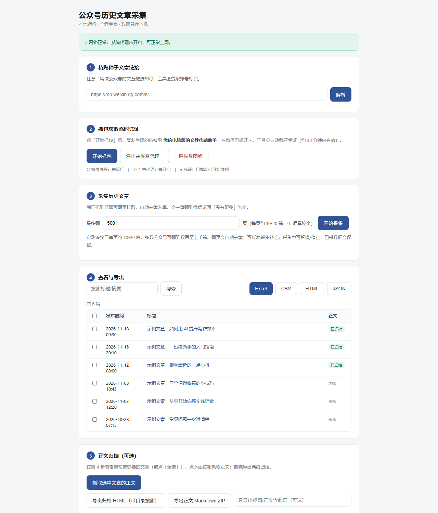

# 公众号历史文章采集器

[](https://github.com/dunkong/wechat-history-collector/actions/workflows/test.yml)
[](LICENSE)
[](requirements.txt)
[](https://github.com/dunkong/wechat-history-collector)

> 给一篇公众号文章链接，采集这个号的全部历史文章，本地存档、导出、正文归档。
> 纯本机运行 · 不调用任何付费接口 · 数据只存本机 · 开源免费（MIT）

一个 Windows 本地工具 + 通用 AI 技能（Skill）。通过微信电脑版抓包拿到临时凭证，翻页拉取公众号历史文章，存入本地 SQLite 并导出多格式文件。可以双击 `.bat` 用网页手动操作，也可以加载为 AI 技能后一句话让 AI 自动完成。

> ⭐ **如果这个项目帮到了你，欢迎点个 Star 支持一下！** [→ GitHub](https://github.com/dunkong/wechat-history-collector)

## 界面预览

| 本地网页界面（点开看大图） |
| :---: |
|  |

*上图为演示模式（`?demo=1`）下的脱敏界面，数据与真实采集结果无关。*

## 特性

- **全量采集**：从种子链接识别公众号，翻页拉取历史文章直到微信返回"没有更多"（数千篇量级），自动去重，可反复补采。
- **多格式导出**：Excel / CSV / HTML（自带搜索）/ JSON。
- **正文归档**：勾选文章抓取正文，导出离线可读的 HTML（左侧目录+搜索）或每篇一个 Markdown 的 ZIP。
- **断点可控**：列表、正文任务均支持暂停/继续/停止，已抓数据实时保留；刷新页面自动恢复任务状态。
- **两种用法**：网页界面（零命令行）或 CLI（单行 JSON 输出，便于 AI/脚本驱动）。
- **断网防护**：三道保险防止抓包代理导致整机断网，附一键急救。
- **数据私有**：数据库、凭证、导出全部在本地 `data/`，已被 `.gitignore` 排除，绝不外传。

## 快速开始（网页，3 分钟）

**环境**：Windows + 微信电脑版（已登录）+ Python 3.9+。

1. 双击 `install.bat` 安装依赖（Flask / requests / openpyxl / mitmproxy）。
2. 双击 `start.bat`，浏览器自动打开 <http://127.0.0.1:8899>。
3. 浏览器打开 <http://mitm.it> 安装 Windows 证书（受信任的根证书颁发机构），装完重启微信。
4. 按页面 4 步操作：

   ① 粘贴种子文章链接 → 解析出公众号
   ② 点「开始抓包」，复制链接到微信电脑版「文件传输助手」并点开 → 状态变为"凭证：已捕获"
   ③ 点「开始采集」（页数填 0 = 尽量拉全），可暂停/停止
   ④ 查看表格、搜索、导出；勾选文章抓正文并归档

5. 采集完点「停止并恢复代理」正常上网。若不小心断网，双击 `reset_network.bat` 急救。

## 给 AI 一句话（推荐）

本仓库根目录就是一个标准 AI 技能（含 `SKILL.md`），可被支持 Skill 格式的 AI Agent 加载。加载后，你不需要记任何命令，只需对 AI 说一句话：

- "采集这个公众号的全部历史文章：<文章链接>"
- "把这个号的文章导出成 Excel"
- "抓取已采集文章的正文，归档成离线 HTML"

AI 会自动完成解析、抓包引导、翻页采集、导出与归档；全程只有一步需要你亲自操作——在微信电脑版里点开链接完成抓包。

### 安装为技能

不同 AI Agent 的技能目录位置不同，把本仓库整个放到对应 Agent 的 skills 目录即可（常见如工作区或用户主目录下的 `skills/wechat-history-collector/`）。仓库根目录含标准的 `SKILL.md`，符合通用 Skill 格式，无需针对特定平台改造。

### 无 AI 参与时：手动运行

`scripts/cli.py` 是技能内部使用的统一入口，所有命令输出单行 JSON、退出码 0 成功，直接调用核心模块（**无需启动 Web 服务**）。手动按顺序执行即可：

```bash
python scripts/cli.py seed "https://mp.weixin.qq.com/s/xxxx" --name "公众号名"
python scripts/cli.py capture start --biz "<biz>"          # 把返回的 profile_url 复制到微信点开
python scripts/cli.py capture status                       # 轮询到 auth_fresh=true
python scripts/cli.py collect --biz "<biz>" --pages 0      # --pages 0 = 拉全
python scripts/cli.py export --name "公众号名"
python scripts/cli.py content --all                        # 抓正文
python scripts/cli.py archive --name "公众号名"             # 正文归档
python scripts/cli.py capture stop                         # 收尾，恢复上网
```

完整命令与字段见 [`references/workflow.md`](references/workflow.md)。

## 工作原理

微信的公众号历史列表不是公开接口，仅凭链接只能拿到账号标识 `__biz`。要拉列表必须有带登录态的临时凭证，不走付费接口的前提下，本机抓包是唯一可行方式：

```
种子链接 → __biz → 微信点主页链接 → mitmproxy 截获 key/pass_ticket/uin/biz
        → getmsg 翻页 → 解析 general_msg_list → SQLite 去重 → 导出/归档
```

正文抓取是普通网页请求（带抓包 Cookie/UA），与列表凭证时效无关。详见 [`references/workflow.md`](references/workflow.md)。

## 项目结构

```
wechat-history-collector/        # 仓库根 = Skill 根
├── SKILL.md                    # 通用 AI 技能定义
├── app.py                      # Flask 本地网页服务（仅监听 127.0.0.1:8899）
├── mitm_addon.py               # 抓包脚本：截获主页凭证
├── requirements.txt            # 依赖
├── install.bat / start.bat / reset_network.bat
├── scripts/
│   ├── cli.py                  # 命令行/自动化统一入口（JSON 输出）
│   └── validate_skill.py       # SKILL.md 规范校验（CI 用）
├── references/
│   ├── workflow.md             # 工作流、CLI、API、字段
│   └── troubleshooting.md      # 故障排查
├── docs/images/                # README 截图（脱敏演示模式）
├── .github/workflows/test.yml  # 多版本 Python 自动测试
├── core/
│   ├── config.py               # 路径与常量
│   ├── seed.py                 # 种子链接 → __biz（含占位符校验）
│   ├── capture.py              # 抓包进程 / 系统代理 / 凭证 / 断网防护
│   ├── collector.py            # getmsg 翻页 + 解析 + 入库
│   ├── content.py              # 正文抓取（标准库解析，零新增依赖）
│   ├── control.py              # 任务暂停/继续/停止控制器
│   ├── store.py                # SQLite 增量存储去重
│   └── exporter.py             # 多格式导出 + 正文归档 HTML/ZIP
├── web/                        # 网页界面
├── data/                       # 运行时数据（.gitignore 排除，不入库）
└── test_*.py                   # 离线自测（均用临时库，不碰真实数据）
```

## 自测

```bash
python test_seed_biz.py     # __biz 占位符校验
python test_pipeline.py     # 种子解析 / 消息解析 / 去重 / 导出 / 搜索
python test_collect.py      # getmsg 多页翻页 + 偏移递增
python test_content.py      # 正文解析 / 存储 / 归档导出
python scripts/validate_skill.py   # SKILL.md 规范校验
```

推送到 GitHub 后，`.github/workflows/test.yml` 会在 Python 3.9 / 3.11 / 3.13 上自动跑以上测试。全部测试使用临时数据库与目录，**不读写真实采集数据**。

## 限制与免责声明

- 历史列表非公开接口，凭证约 30 分钟有效；`getmsg` 翻页有平台上限，极老账号不保证"从建号至今全量"，可反复采集去重补全。
- 首次使用需安装本地 CA 证书 + 采集时在微信点一次链接，这是微信机制决定，无法省略。
- 本工具仅用于个人学习研究、存档公开文章，不用于商业用途或批量爬取转载。使用请遵守微信软件协议及相关版权法规，由此产生的责任由使用者自行承担。

## License

[MIT](LICENSE) © 2026

---

⭐ **觉得有用？点个 Star 让更多人看到** → [github.com/dunkong/wechat-history-collector](https://github.com/dunkong/wechat-history-collector)

欢迎 Issue / PR 反馈问题与改进建议。
